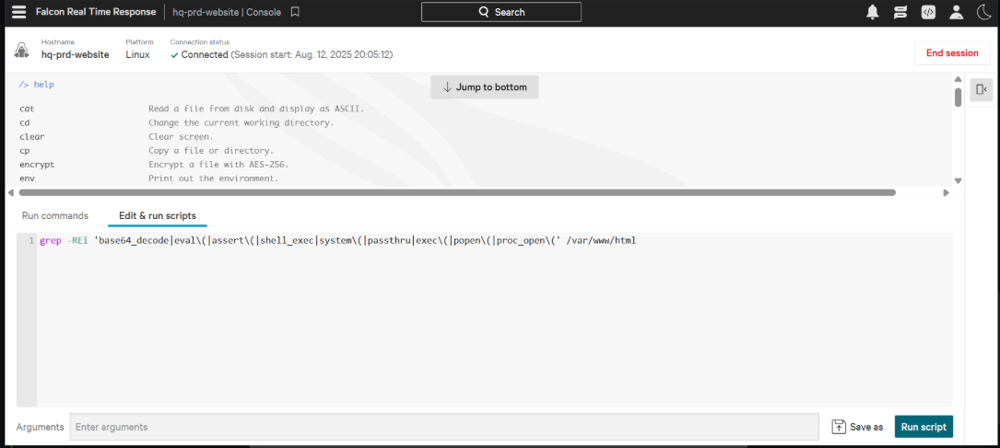
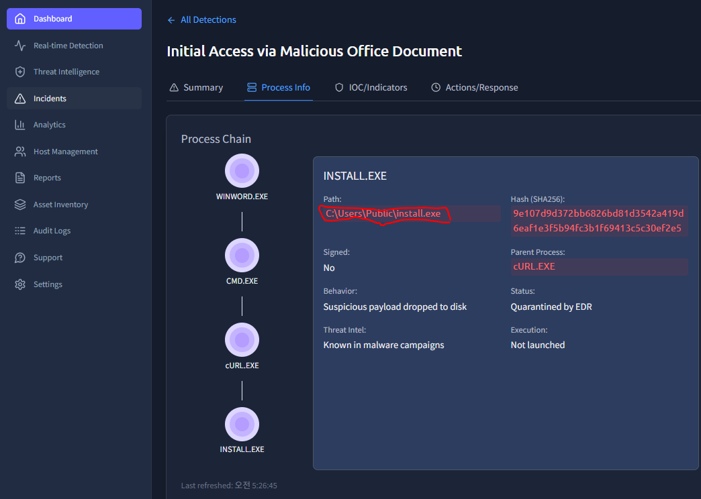
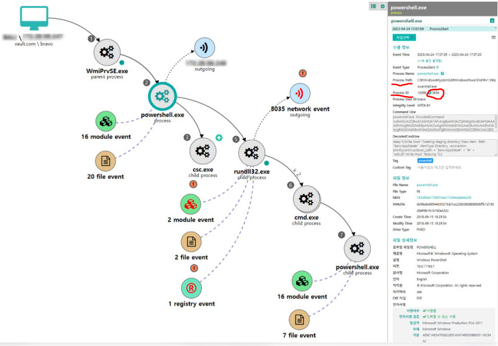
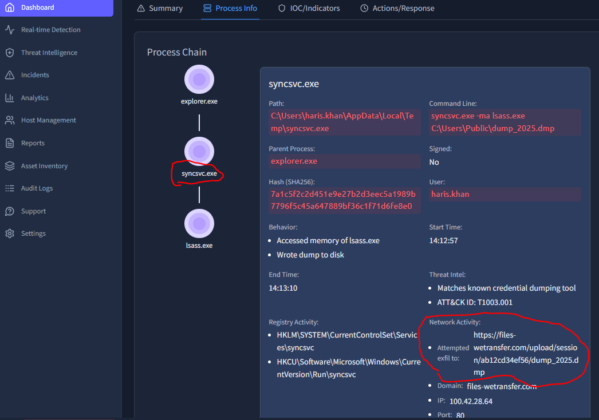
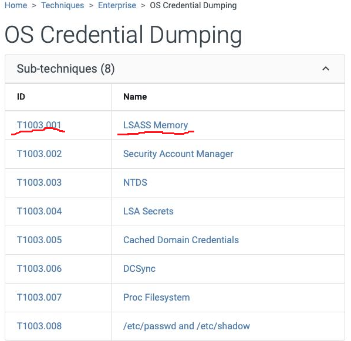

1. Telemetry

    • EDR environments contain a mix of legitimate and malicious activity, and distinguishing between the two can be challenging. Collecting more relevant data can support better-informed decisions.
    • The following are examples of telemetry collected by EDR systems.
① Process Executions and Terminations
    • Track processes, including those that are running or idle.
    • Attacker activity may include preparing to exfiltrate data, executing ransomware, or installing malicious files.
    • EDR tracks these activities, helping analysts detect advanced threats and better assess whether observed behavior is legitimate.
    • Analysts can understand the full chain of events, identify the root cause, and reconstruct the attack timeline.

2. Detection and Response Capabilities
    • In this module, we explore advanced detection techniques and response mechanisms.

3. Response

    • Detection is followed by response.
    • EDR systems support both manual and automated responses. Manual response can give analysts more flexibility in choosing how to respond.
    • If malicious activity occurs on an endpoint, analysts can use EDR to isolate that endpoint from the network.
    • Many attacks begin on one endpoint, then spread laterally to others, potentially compromising the wider network. Isolating an infected endpoint can help prevent this spread.
    • Some hosts support critical business operations, so isolating them could cause greater disruption than the malicious activity itself. In such cases, terminating the malicious process instead of isolating the host may be more appropriate.
    • Analysts can terminate processes on an endpoint.
    • If a malicious file reaches an endpoint, analysts can quarantine it. Quarantine moves the file to a separate location where it cannot be executed. After reviewing the file, analysts can restore it or permanently delete it.
    • Analysts can also remotely access endpoint shells to run commands and scripts.

    
    (CrowdStrike Falcon is a relevant EDR platform used in managed security environments, including MSSP operations.)

    1. Falcon Real Time Response (This work goes beyond basic monitoring and involves hands-on security analysis.)
        ◦ Analysts access an endpoint shell to run commands and scripts.
        ◦ In some cases, analysts may need to collect endpoint artifacts—such as memory dumps, event logs, contents of specific folders, or registry hives—for in-depth forensic investigations or reports supporting potential legal action.

    2. Hands-on Exercise Scenario
        ◦ In this exercise, you have access to an EDR platform as a SOC analyst and receive multiple high-severity detections. For each detection, you prioritize the alert and assess whether it represents a real attack. In practice, EDR platforms are often used alongside SIEM systems.

        
        Verify the absolute path: I opened the related events on the high-severity host DESKTOP-HR01. and compared the process execution flow with file-creation events. In the Process Info tab, I identified the process responsible for the download, then checked the target path in the file-creation event to determine the payload’s absolute path. 

    
 When reviewing parent–child relationships in an EDR process tree, follow the direction of the solid arrows (parent → child), tracing execution from top to bottom and left to right. Cross-check the execution context using the PID, Parent PID, and Command Line in the details panel on the right.
 1. How to Read Parent–Child Relationships in the Process Tree
A solid black arrow (→) between process nodes indicates that the parent process on the left or above launched the child process on the right or below.
A dashed arrow (--->) represents an event—not process creation—such as a network connection, module load, file creation, or registry modification.
 2. Verification Points in the Details Panel
Do not rely on the graph alone. For the selected node—in the current screenshot, powershell.exe—also review the following fields in the details panel on the right.

I investigated a suspicious process that accessed LSASS memory and created a memory dump. I also confirmed that it attempted to send the dump file to an external URL, and verified in the EDR console that the connection was blocked.
Investigation flow: Process analysis → identification of suspected credential theft involving LSASS → review of network communications to an external upload URL → assessment of a potential data exfiltration attempt based on the LSASS dump and upload attempt → response actions: isolate the host, quarantine the file, and use the EDR remote shell for further investigation.

Conclusion: In addition to the tools I used and concepts I learned during the hands-on exercises, I have described the skills required to work with and monitor EDR systems as a SOC Analyst. 

