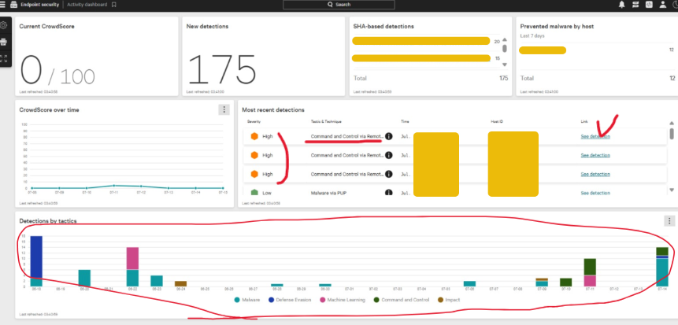

## Activity Dashboard Triage & Prioritization

On the Activity Dashboard, a SOC Analyst prioritizes high-risk alerts over the total volume of new detections to conduct effective alert triage.

* **Priority Alerts**: Highlighted in red, the three `High` severity detections are prioritized for immediate investigation.
* **MITRE ATT&CK Context**: The `Command and Control via Remote...` classification indicates high-risk activity where an internal host attempts to communicate with an external C2 server
* **Next Investigation Steps**: Click `See detection` to inspect the underlying process tree, command-line arguments, and external network connections to determine whether immediate host isolation is required.

**Key Panel to Check First**

All three of the top detections currently have a High severity rating and are categorized under Tactic & Technique: Command and Control via Remote…. Command and Control (C2) activity can indicate that an internal host is compromised and attempting to communicate with an external attacker-controlled server. This should be treated as a high-priority alert.

The analyst should immediately click See detection on the right to review the affected Host ID, the process involved, and the external IP address. Based on those details, the analyst should assess whether to place the host in Network Containment.

**Detections by Tactic and New Detections: Analyzing Attack Trends and Spikes**

The charts show periods of relatively low activity followed by spikes in high-risk tactics—including Defense Evasion, Command and Control, and Impact—on dates such as 06-18, 06-22, 07-11, and 07-14. These increases may indicate changes in attack activity and warrant further investigation.
